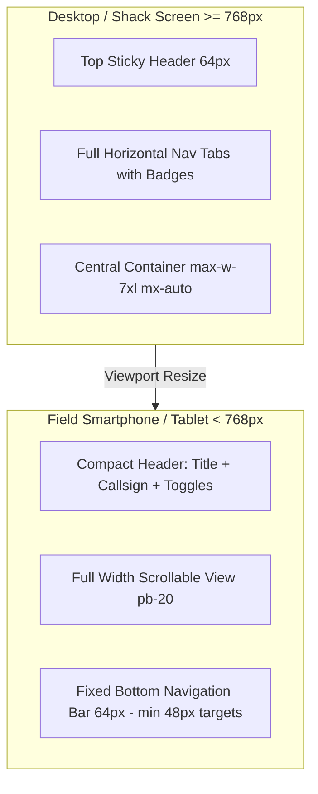

# Design System: Hardy Ham DTN Web Console

## 1. Overview & Brand Identity

The **Hardy Ham DTN Web Console** is the companion visual interface for the `dtn-hdy-ham` Bundle Protocol Agent (BPv7 - RFC 9171), specifically crafted for **amateur radio operators**.

The application is deployed across two primary operational paradigms:
1. **The QRA (Home Station Shack)**: Desktop monitors, multi-screen setups, continuous 12V/230V power, stable local LAN or Wi-Fi, interfaced with base HF/VHF/UHF transceivers and TNCs.
2. **Field / Portable / EmComm (SOTA, POTA, ADRASEC, Disaster Response)**: Field tablets, ruggedized smartphones, battery-powered Raspberry Pi in a backpack, operating in remote mountainous or off-grid environments under direct sunlight or total darkness, often manipulated with damp or gloved hands.

Consequently, the UI must balance **dense technical information** (RF parameters, DTN EIDs, SenML telemetry, hex dumps, BPSec cryptographic authentication) with **maximum frugality, zero cloud roundtrips, and rugged offline resilience**.

---

## 2. Core Design Principles

### 2.1. Frugality & Zero Cloud Dependencies (Offline-First)
* **Zero External Network Calls**: The UI strictly forbids external CDNs (`fonts.googleapis.com`, `cdnjs`, `unpkg`). All assets (Preact runtime, Tailwind compiled CSS, SVG icons, Web Audio synthesizers) are compiled directly into the binary and cached locally.
* **Stand-Alone PWA**: Implements a dedicated Service Worker caching the entire App Shell (`manifest.webmanifest`, icons, JS bundles). Even if the radio link or local Wi-Fi drops completely, the operator can consult cached conversations, view stored files, read system logs, and queue outgoing bundles.
* **Minimal Energy Footprint**: Zero heavy rendering libraries (no WebGL, no heavy 3D canvases, minimal animation). Renders cleanly on low-power ARM single-board computers (Raspberry Pi 3/4/Zero 2W).

### 2.2. Field Ergonomics & Gloved Touchability
* **Strict 48px Minimum Touch Targets (`touchTargetMin: 48px`)**: Every interactive button, tab, icon-only action, modal close, and voice recording toggle strictly honors a minimum $48 \times 48\text{px}$ hitbox to ensure 100% usability with cold, damp, or gloved hands in field deployments.
* **Mobile Thumb Zone Bottom Navigation**: On viewports $< 768\text{px}$ (`md`), navigation switches from a desktop top header to a fixed, elevated bottom navigation bar (`fixed bottom-0 left-0 right-0 z-40 pb-[env(safe-area-inset-bottom)]`), allowing seamless one-handed thumb navigation while holding a handheld radio transceiver in the other hand.
* **Keyboard Accessibility (WCAG 2.1 AA)**: Skip links (`#main-content`), explicit `aria-label`, visible focus rings (`focus:ring-2 focus:ring-emerald-500`), modal `role="dialog"` with `Escape` dismiss, and full keyboard navigation across cards and lists (`Enter`/`Space`).

### 2.3. Extreme Lighting Contrast (Direct Sunlight vs. Night Vision)
* **High-Contrast Light Mode (`#ffffff` & `#f8fafc`)**: Crisp slate text (`#0f172a`) on stark white surfaces with subtle slate borders, optimized for direct solar glare during outdoor daytime activations.
* **Deep OLED Dark Mode (`#0f172a` & `#1e293b`)**: Midnight slate palette avoiding pure black harshness while saving battery on mobile OLED screens and preserving operator night vision during night-time emergency communications.
* **Instant Mode Toggle**: Always accessible in the top-right header via a dedicated 48px button (`☀️` / `🌙`).

### 2.4. Audio Observability with Operational Discretion
* **In-Browser Synthesized Sound**: Notification chimes are synthesized directly in code via the browser's native `AudioContext` (pure sine wave harmonics at 587.3 Hz / 880 Hz with gentle exponential decay), requiring zero audio file transfers over the air.
* **Instant Silence Toggle**: Visible bell icon (`🔔` / `🔕`) in the header allowing immediate muting when radio monitoring requires acoustic silence.
* **Native Web Notifications**: Optional system notifications alert operators of incoming chat bundles when the screen is off or unfocused.

---

## 3. Color Tokens & Semantic Guidelines

### 3.1. Palette Definitions

```
Emerald / Ham Primary:
  50:  #f0fdf4
  100: #dcfce7
  400: #34d399 (Dark mode accents)
  500: #22c55e (Badge green)
  600: #059669 (Primary brand & buttons)
  700: #047857 (Hover states)
  800: #166534
  900: #14532d

Slate Neutrals:
  50:  #f8fafc (Light Canvas)
  100: #f1f5f9 (Light Sub-canvas)
  200: #e2e8f0 (Light Border)
  400: #94a3b8 (Dark Secondary Text)
  500: #64748b (Light Secondary Text / Unsigned Status)
  700: #334155 (Dark Border)
  800: #1e293b (Dark Surface / Card)
  900: #0f172a (Dark Canvas)
```

### 3.2. Semantic Radio Link States

| State | Badge Color | Light Background | Dark Background | Semantic Meaning |
| :--- | :--- | :--- | :--- | :--- |
| **Live / Connected** | `#10b981` (emerald-500) | `bg-emerald-50 border-emerald-300` | `bg-emerald-950/60 border-emerald-800` | CLA link open, TCPCL session connected, SSE live stream flowing |
| **Connecting / Pacing** | `#f59e0b` (amber-500) | `bg-amber-50 border-amber-300` | `bg-amber-950/60 border-amber-800` | Pacing delay active, contact window pending, reconnection backoff |
| **Disconnected / Fault** | `#f43f5e` (rose-500) | `bg-rose-50 border-rose-300` | `bg-rose-950/60 border-rose-800` | Link closed, radio unkeyed, SSE disconnected, carrier lost |

### 3.3. BPSec RFC 9103 Cryptographic Trust Badges

To avoid false senses of security without alarming operators on open amateur RF channels:
* **Valid Signature (🛡️)**: Emerald badge (`bg-emerald-50 dark:bg-emerald-950/60 text-emerald-700`). HMAC-SHA256 verified against `keystore.toml`.
* **Invalid Signature (⚠️)**: Red badge (`bg-rose-50 dark:bg-rose-950/60 text-rose-700`). Tampered bundle, signature mismatch, or corrupted over RF.
* **Unsigned / Missing Key (❓)**: **Neutral Slate** badge (`bg-slate-100 dark:bg-slate-800 text-slate-600 dark:text-slate-400`). Standard amateur radio cleartext bundles are expected to be unsigned; neutral coloring avoids visual panic while signaling lack of authentication.

---

## 4. Typography & Readability

```
Sans-Serif (Interface & Headings):
  font-family: system-ui, -apple-system, BlinkMacSystemFont, "Segoe UI", Roboto, sans-serif;

Monospace (EIDs, Callsigns, Telemetry, Hex, Logs):
  font-family: ui-monospace, SFMono-Regular, Menlo, Monaco, Consolas, monospace;
```

### Typographic Hierarchy & Guidelines
1. **Station Callsign**: Always rendered in bold monospace (`font-mono font-bold`) with emerald highlight (`text-emerald-600 dark:text-emerald-400`). Example: `F4JDR`, `F5KUV`, `VK2DTN`.
2. **DTN Endpoint Identifiers (EIDs)**: Formatted in monospace (`font-mono text-xs sm:text-sm`) with soft wrapping or truncation and a 1-tap copy button. Example: `dtn://f4jxq-9/chat`, `ipn:1.2`.
3. **Telemetry Numbers**: Formatted in bold tabular numbers (`font-mono font-bold text-2xl`) accompanied by explicit engineering units (`°C`, `hPa`, `V`, `dBm`).
4. **Hex Dumps**: 16-byte aligned monospace grid with byte offset, hex values, and ASCII side-by-side gutter.

---

## 5. Layout & Navigation Hierarchy

### 5.1. Navigation Architecture (5 Lean Core Views + Station Sub-Navigation)

Pour offrir une ergonomie lean et optimale sur les écrans de terrain (tactiles, smartphones en extérieur, gants), la navigation principale est épurée à 5 vues applicatives centrées sur l'utilisateur DTN, tandis que la gestion et le diagnostic station sont regroupés au sein d'onglets secondaires dans **Station** :

```
[📡 Hardy BPA Hamradio]  [🟢 Live] [F4JDR · dtn://f4jdr/]  [🔔] [🌙]
----------------------------------------------------------------------
Navigation principale (5 onglets) :
[⚙️ Station] [💬 Chat (3)] [📁 Files (1)] [📊 SenML] [✉️ Send Bundle]
```

#### Vues Principales DTN
1. **`⚙️ Station` (`ConfigView.tsx`)**: Hub d'administration, surveillance et configuration de la station radio DTN (voir sous-navigation ci-dessous).
2. **`💬 Chat` (`ChatView.tsx`)**: Fils de discussion pair-à-pair (`dtn://<peer>/chat`), statut de livraison des outbox (⏳ En attente, 📤 Émis, ✅ Livré), bulles Markdown sécurisées, compteurs de non-lus.
3. **`📁 Files` (`FilesView.tsx`)**: Explorateur de fichiers permanents reçus/stockés sur `dtn://<node>/files`, épinglage persistant anti-reaper, prévisualisation multi-formats (Markdown, Audio, Images, Hex).
4. **`📊 SenML` (`SenmlView.tsx`)**: Tableaux de bord IoT/télémétrie RFC 8428 (`SENML_LAST`), heure UTC/relative, réorganisation par drag-and-drop, alias personnalisés.
5. **`✉️ Send Bundle` (`SendBundleView.tsx`)**: Répartiteur générique de bundles pour messages ad-hoc, fichiers joints et enregistrement audio de notes vocales (remuxing WebM $\rightarrow$ Ogg/Opus).

#### Sous-Navigation « Station » (6 sous-onglets)
Accessible via la barre de segmentation horizontale sous l'en-tête de la station :
* **`📡 Liaisons & Radio` (`radio`)**: Carte d'identité radio, moteur de stockage, interfaces réseau, services DTN actifs (Echo, etc.), et adaptateurs de couche de convergence (CLAs) avec statut et connexion forcée.
* **`🧭 Routage (RIB)` (`routes`)**: Table des routes statiques BPv7 injectées dans le RIB, formulaire d'ajout dynamique et suppression sans redémarrage.
* **`🛡️ Sécurité BPSec` (`security`)**: Gestionnaire de clés HMAC-SHA256 (RFC 9103 / RFC 9172), trousseau local protégé (`keystore.toml`), sélecteur de politique d'ingestion (Strict, Warn, Ignore) et générateur aléatoire 256 bits.
* **`📦 Stockage & Paquets` (`bundles`)**: Inspecteur de la base de données locale des bundles (Inbox, Outbox, Delivered), détails complets, badge de confiance cryptographique et visionneuse hexadécimale.
* **`📟 Traces & Diagnostic` (`logs`)**: Console de logs en temps réel connectée au tampon circulaire en mémoire (SSE), filtres de niveau (`INFO`, `WARN`, `ERROR`), recherche plein-texte et gel du défilement.
* **`⚙️ Configuration JSON` (`advanced`)**: Visualiseur de la configuration active complète au format JSON avec bouton de copie en 1 clic.

Deep-linking et rétrocompatibilité des URLs supportés via le hash :
`#/station/radio`, `#/station/routes`, `#/station/security`, `#/station/bundles`, `#/station/logs`, `#/station/advanced` (avec alias automatiques pour `#/bundles`, `#/logs` et `#/config`).

### 5.2. Viewport Adaptation



---

## 6. Components & Design Patterns

### 6.1. Cards & Containers
* Surfaces use `bg-white dark:bg-slate-800` with subtle rounded borders `rounded-xl border border-slate-200 dark:border-slate-700 shadow-xs`.
* Card headers clearly separate title, metadata chips, and action buttons.
* Density: High information density without clutter, using concise spacing (`space-y-4`, `p-4 sm:p-6`).

### 6.2. Interactive Buttons & Actions
* **Primary Actions**: `bg-emerald-600 hover:bg-emerald-700 text-white font-medium rounded-lg shadow-xs min-h-[48px] px-4`.
* **Secondary / Neutral Actions**: `bg-slate-100 hover:bg-slate-200 dark:bg-slate-700 dark:hover:bg-slate-600 text-slate-700 dark:text-slate-200 rounded-lg min-h-[48px] px-3`.
* **Destructive Actions (Delete bundle / key)**: `text-rose-600 hover:bg-rose-50 dark:hover:bg-rose-950/40 rounded-lg min-h-[48px] px-3`.
* **Feedback States**: Buttons display loading spinners or disabled opacity (`opacity-50 cursor-not-allowed`) while async operations complete.

### 6.3. Modals & Drawers
* Accessible dialogs with `role="dialog"`, `aria-modal="true"`, and `aria-labelledby`.
* Backdrop overlay `bg-slate-900/60 backdrop-blur-xs` preventing interaction with background elements.
* Dismissible via explicit Close button ($\ge 48\text{px}$), backdrop click, or `Escape` keypress.

### 6.4. Voice Note Microphone Recorder
* One-touch recording button in `SendBundleView.tsx` with animated pulse indicator while recording (`animate-pulse text-rose-500`).
* Live elapsed timer and HTML5 audio playback preview with waveform/scrubber before transmitting over RF.
* Automatic in-browser container conversion from browser WebM to compliant amateur radio RFC 7845 Ogg/Opus on backend injection.

### 6.5. System Log Terminal
* Styled with dark terminal aesthetics: `bg-slate-950 text-slate-100 font-mono text-xs rounded-xl p-4 border border-slate-800`.
* Color-coded log severity badges: `INFO` (emerald), `WARN` (amber), `ERROR` (rose), `DEBUG` (cyan), `TRACE` (purple).
* Automatic pause of auto-scroll upon user scroll-up; resume on bottom snap or manual toggle button.

---

## 7. Performance & Bandwidth Budget

| Asset / Layer | Budget / Constraint | Implementation Reality |
| :--- | :--- | :--- |
| **Total JavaScript Bundle** | $< 120\text{ KB}$ gzipped | Preact + Vite lightweight footprint (~45 KB gzip) |
| **Total CSS Stylesheet** | $< 25\text{ KB}$ gzipped | Purged Tailwind utility classes (~12 KB gzip) |
| **External Fonts** | $0\text{ KB}$ (No external requests) | System font stacks (`system-ui`, `monospace`) |
| **External Icons** | $0\text{ KB}$ (No external fonts) | Inline SVG & standardized unicode radio emojis |
| **Initial Page Load over LAN** | $< 100\text{ ms}$ | Immediate local server response |
| **Offline Reload (Service Worker)** | $< 30\text{ ms}$ | Cache-First instantaneous PWA launch |

---

## 8. Summary for Autonomous AI Coding Agents

When adding or refactoring UI components in `dtn-hdy-ham/web`:
1. **Never introduce external CDN URLs**: No fonts, scripts, or stylesheets from outside the host origin.
2. **Always respect 48px minimum touch targets**: Check buttons and inputs with `min-h-[48px] min-w-[48px]`.
3. **Always preserve dual-mode contrast**: Ensure every text and surface uses both light and dark classes (`text-slate-900 dark:text-slate-100`, `bg-white dark:bg-slate-800`).
4. **Use semantic tokens**: Use `emerald` for active/healthy states, `amber` for pacing/transient delays, `rose` for faults/disconnections, and neutral `slate` for unsigned bundles.
5. **Keep bundle payload serving secure**: Keep `Content-Security-Policy: default-src 'none'; sandbox` and `X-Content-Type-Options: nosniff` intact on payload endpoints.
