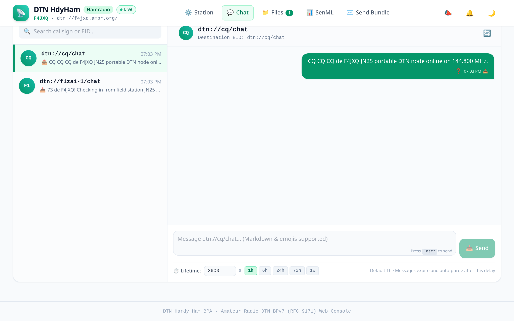
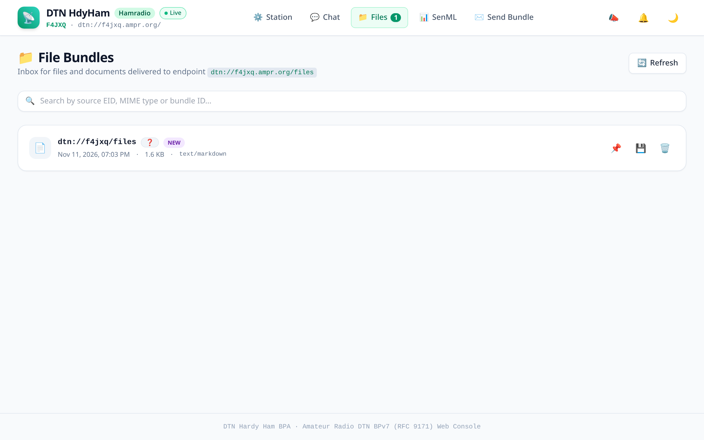
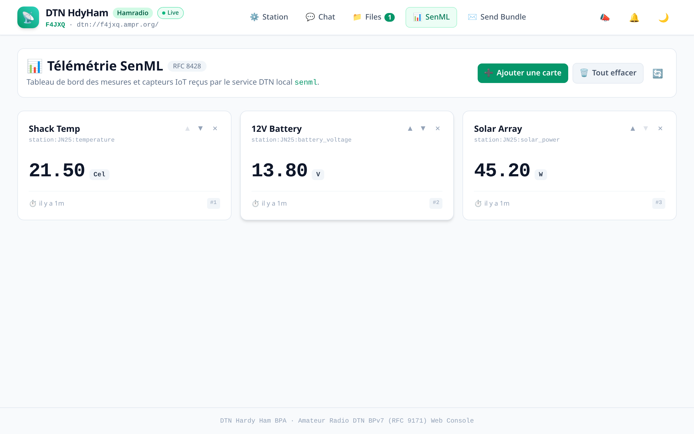
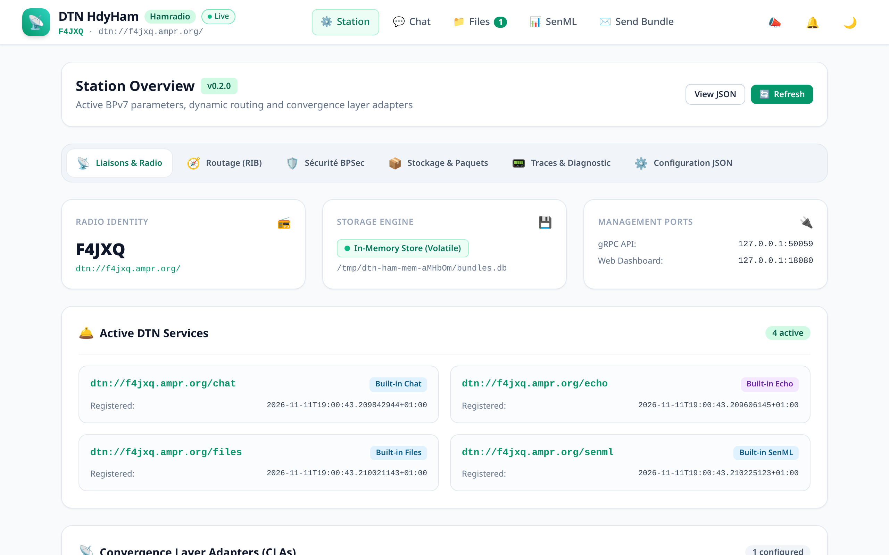
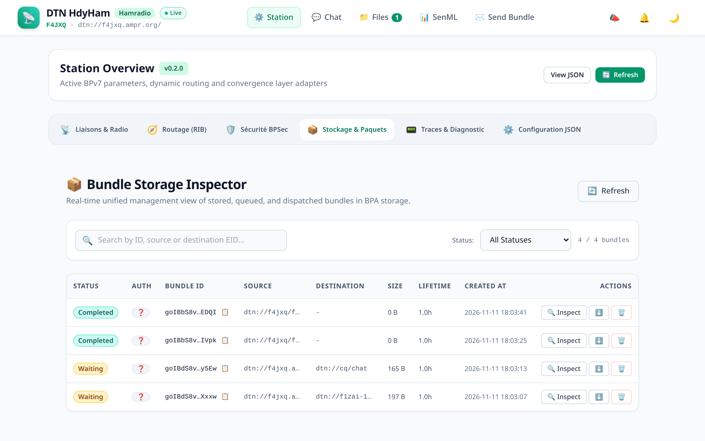

# 📻 `dtn-hdy-ham` — Delay-Tolerant Networking (DTN) BPv7 Node & Web Console for Amateur Radio

[](https://www.rfc-editor.org/rfc/rfc9171.html)
[](../LICENSE)
[](https://github.com/loic-fejoz/dtn-hdy-utils/releases)
[](#supported-radio-interfaces--convergence-layers)

**`dtn-hdy-ham`** is a self-contained, standalone **Bundle Protocol version 7 (BPv7 / RFC 9171)** node and Web Console specifically engineered for **amateur radio operators**, **emergency communication teams (EmComm / ARES / FNRASEC)**, and **portable / off-grid field deployments (SOTA / POTA)**.

It turns any computer, Raspberry Pi, or laptop into a resilient, autonomous communication hub capable of relaying messages, distributing files, and aggregating telemetry across intermittent, high-latency, or completely disconnected radio links.

---

## 🌟 What Does It Bring To You?

### 1. Reliable Off-Grid Communication When Everything Else Fails
In disaster scenarios, remote summits, or maritime trips, traditional internet and cell service are unavailable. `dtn-hdy-ham` relies on **Store-and-Forward** bundle routing: your messages and files are stored safely in local storage and forwarded automatically the moment another station, relay satellite, or mobile gateway comes into radio range.

### 2. Zero-Install Web Dashboard (Any Browser, Any Device)
No need to install complex client software on every terminal. Run `dtn-hdy-ham` and immediately access the responsive, mobile-friendly **Web Console** at `http://127.0.0.1:8080`:
- Connect from your PC, laptop, tablet, or smartphone connected to the station's Wi-Fi hotspot.
- Progressive Web App (PWA) offline-first architecture with high-contrast day and dark modes.

### 3. Asynchronous & Real-Time Ham Chat
- **Peer-to-Peer & Broadcast (`CQ`) messaging**: Talk directly to specific stations (`dtn://f1zai/chat`) or call general stations (`CQ`).
- **Visual Delivery States**: Track whether your messages are `queued`, `sent`, or `delivered`.
- **Sticky Messages**: Pin important messages (frequencies, schedules, emergency updates) to prevent them from expiring.

### 4. Resilient File Sharing & In-Browser Payload Inspection
- Transmit emergency plans, APRS/packet bulletins, maps, audio notes, or configuration files.
- Built-in live payload viewer: preview text, markdown, sensor data, audio clips, and raw hex dumps directly in your browser without external tools.

### 5. Live Station Telemetry & Sensor Dashboard (SenML RFC 8428)
- Monitor battery voltage, solar panel charging, temperatures, and RSSI.
- Fully compatible with RFC 8428 SenML telemetry streams. Customize your station dashboard with real-time gauge cards and historical data.

### 6. Amateur Radio Regulatory Compliance Out-of-the-Box
- **Plaintext & Unencrypted by Default**: Compliant with international amateur radio laws forbidding encryption.
- **BPSec Authenticity without Encryption**: Verify message origin and tamper-proofing using BPSec HMAC signatures while leaving payloads in readable plaintext.
- **Native Callsign EIDs**: Address peers naturally using amateur callsigns (e.g. `dtn://n0call/` or `N0CALL-1`).

---

## 📸 Visual Showcase

### Interactive Ham Radio Chat
Exchange direct messages or call `CQ` over VHF/UHF packet or Hamnet links with delivery tracking and sticky pinning:



---

### File Distribution & Payload Inspector
Inspect received files, read markdown documents, preview telemetry, or view raw hex dumps directly from the browser:



---

### Live Station Telemetry (SenML RFC 8428)
Track shack environment, solar array power, battery levels, and link signal strength with customizable cards:



---

### Station Radio & Convergence Layer Management
Monitor active radio interfaces, connection states, routing rules, and local node identification:



---

### Bundle Storage & Route Diagnostics
Deep-dive into the local BPv7 bundle store, inspect bundle headers, lifetime expiration, and BPSec verification:



---

## ⚡ 30-Second Quick Start

### Step 1 — Download the Release
Download the precompiled static binary archive for your architecture from the [Releases Page](https://github.com/loic-fejoz/dtn-hdy-utils/releases) (Linux x86_64, Linux ARM64, macOS, Windows).

### Step 2 — Initialize Your Callsign
Run the interactive setup wizard:
```bash
./dtn-hdy-ham init
```
Or copy the reference configuration and customize your callsign:
```bash
cp config.example.toml config.toml
# Edit callsign = "YOUR_CALLSIGN" and node-id = "dtn://yourcall/"
```

### Step 3 — Launch the Node
```bash
./dtn-hdy-ham -c config.toml
```

### Step 4 — Open the Web Dashboard
Navigate to **`http://127.0.0.1:8080`** in your browser. You are now running an active DTN node!

---

## 📡 Supported Radio Interfaces & Convergence Layers

`dtn-hdy-ham` bridges modern high-speed networks and classic narrowband amateur radio modems:

| Convergence Layer | Protocol | Typical Medium | Description |
|---|---|---|---|
| **Hamnet / LAN TCPCLv4** | RFC 9174 | Hamnet (5.8 GHz), AREDN, LAN, WireGuard | High-throughput, plaintext TCPCLv4 connections between fixed shacks. |
| **Hamradio Quick File Broadcast Protocol** | HQFBP / KISS | 2m / 70cm VHF/UHF (1200 / 9600 bauds) | Connects via TCP to Direwolf soundcard modems or hardware KISS TNCs. |
| **LTP (Licklider Protocol)** | RFC 5326 / KISS | HF, Satellite, Moonbounce, High-Latency Links | Long-haul delay-tolerant transport with automatic red/green retransmissions over any KISS, eg Mercury. |
| **Mercury ARQ** | Mercury TNC | HF narrowband connected mode | Robust connected ARQ transport over challenging acoustic/RF links. |

---

## 🧰 Bundled CLI Utilities Included

`dtn-hdy-ham` provides a standard local gRPC interface (`127.0.0.1:50051`) allowing companion CLI tools to automate operations or integrate with scripts:

- **`dtnsend`**: Transmit arbitrary text, payloads, or files to any destination EID.
- **`dtnprint`**: Listen on a service endpoint and output received payloads to stdout or scripts.
- **`dtnfiles`**: Command-line file distribution and directory synchronization over DTN.
- **`dtntrigger`**: Execute shell commands or trigger alerts automatically upon bundle arrival.
- **`dtnping`**: Measure round-trip time (RTT) and hop counts across the DTN mesh.
- **`dtnbasket` / `dtnbasket-cli`**: Delay-tolerant proxy fetching remote web, Gemini, and local file resources.
- **`hdy-stats`**: Background service monitoring traffic and answering stats queries.

---

## 🎯 Typical Operating Scenarios

### 🏕️ Portable Field Operations (SOTA / POTA / Go-Box)
Run `dtn-hdy-ham` on a Raspberry Pi Zero 2W or Pi 4 connected to a handheld radio (HT) via a Digirig and Direwolf. Operators in the field connect their phones to the Pi's Wi-Fi access point and exchange messages, spot reports, and weather telemetry without cell reception.

### 🏠 Fixed Shack & Hamnet Gateway (QRA)
Deploy `dtn-hdy-ham` as a systemd background service on your shack server. It bridges local VHF packet radio traffic onto the regional Hamnet / AREDN mesh, acting as an automated relay and message custodian for portable stations.

### 🚨 Emergency Communications (EmComm / ARES / ADRASEC)
Set up a localized emergency network across multiple shelters or incident command posts. Messages, medical supply lists, and situation reports circulate automatically as mobile vehicles equipped with DTN nodes travel between sites.

### 🛰️ Remote & Unattended Ground Stations (CubeSat / SatNOGS / Mountain Repeaters)
Deploy `dtn-hdy-ham` on isolated, automated ground stations (e.g. mountain summits, remote tracking stations, or solar-powered amateur repeaters). During brief orbital passes or line-of-sight windows, downlinked telemetry, weather data, and scientific payloads from CubeSats or high-altitude balloons (HAB) are captured via AX.25, HQFBP, or LTP, buffered safely in local storage, and opportunistically forwarded to mission control whenever backhaul connectivity (Hamnet, Starlink, or intermittent cellular) becomes active.

---

## 📚 Documentation & Reference Guides

- 📖 [**QUICKSTART.md**](QUICKSTART.md): Step-by-step setup guide, systemd service deployment, and CLI examples.
- 🎨 [**DESIGN.md**](DESIGN.md): Complete UI/UX design specifications, color tokens, and PWA design philosophy.
- 🗺️ [**ROADMAP.md**](ROADMAP.md): Feature matrix, upcoming developments, and protocol parity roadmap.
- ⚙️ [**config.example.toml**](config.example.toml) / [**config.example.yaml**](config.example.yaml): Fully annotated configuration templates.

---

## 📄 License

Licensed under either of:
- Apache License, Version 2.0 ([LICENSE-APACHE](../LICENSE-APACHE) or http://www.apache.org/licenses/LICENSE-2.0)
- MIT license ([LICENSE-MIT](../LICENSE-MIT) or http://opensource.org/licenses/MIT)

at your option.
