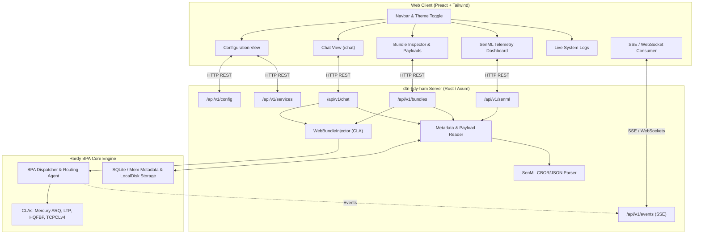

# Roadmap: Aligning `dtn-hdy-ham` with `dtn-android-messenger`

## 1. Executive Summary & Vision

The objective of this roadmap is to elevate the web application of **`dtn-hdy-ham`** to offer full user-facing feature parity with the companion native mobile application [**`dtn-android-messenger`**](../dtn-android-messenger/README.md).

`dtn-android-messenger` provides amateur radio operators with an intuitive mobile terminal for Delay/Disruption-Tolerant Networking (DTN BPv7 - RFC 9171), featuring:
* A conversation-based **Chat service** (`dtn://<callsign>/chat`).
* A rich **Bundle Inspector** supporting automatic detection and rendering of Markdown, images, vocal notes (audio), and binary payloads.
* A live **SenML Telemetry Dashboard** (RFC 8428) displaying real-time IoT and sensor values with custom labels and historical graphs.
* Dynamic management of **Local Services**, **Static Routes**, **Convergence Layer Adapters**, and **BPSec BIB HMAC-SHA256 authentication** (RFC 9103).

By combining `dtn-hdy-ham`'s high-performance in-process Rust BPA (`hardy`), its amateur radio CLAs (LTP, HQFBP, Mercury ARQ, TCPCLv4), and a modern responsive web frontend (Vite + Preact + Tailwind CSS), operators will enjoy a cross-platform desktop and mobile web interface with zero installation overhead.

---

## 2. Feature Parity & Gap Analysis Matrix

| Feature / Domain | `dtn-android-messenger` (Kotlin/Compose) | `dtn-hdy-ham` Current State | Target in `dtn-hdy-ham` Web Console |
| :--- | :--- | :--- | :--- |
| **Configuration Dashboard** | Read/write settings in SQLite Room DB | **Delivered (WP1)**: Read-only active config cards & JSON inspector | WP6: Add interactive runtime configuration |
| **Generic Bundle Sending** | Dedicated screen for text & files | **Delivered (WP1)**: REST API & Form for text and file attachments | WP2: Enhanced with BPSec flags & preview |
| **Bundle Storage & Inspection** | Registry of all bundles (inbox, outbox, delivered) + detail view | BPA storage only (no web listing) | **WP2**: Tabbed bundle list, metadata inspector, payload renderers |
| **Payload Renderers** | Auto-detects Text, Markdown, Image, Audio, Hex | Raw payload download only | **WP2**: In-browser Markdown, Image viewer, Audio player, Hex viewer |
| **Chat Service** | Conversational bubble thread grouped by peer | Generic sending only | **WP3**: Conversational thread UI, auto-reply, chat bubbles, unread tracking |
| **Real-Time Push / Updates** | Reactive Room DB Kotlin Flows | Manual refresh / polling required | **WP4**: WebSocket / Server-Sent Events (SSE) for live event streaming |
| **System Event Logs** | Dedicated `SystemLogScreen` | Terminal logs only | **WP4**: Web-based real-time log viewer with filter & search |
| **SenML Telemetry** | `SENML_LAST` cards & `SENML_GRAPH` time series | None | **WP5**: RFC 8428 SenML decoder, sensor card dashboard & historical charts |
| **Service Registry** | Dynamic registration of local EIDs & Viewer Types | Static YAML config only | **WP6**: Register/deregister services with UI viewer binding |
| **Static Routing & BPSec** | Rule editor + BIB key management | YAML config only | **WP6**: Route manager + BIB key vault & verification policy |
| **Mobile & Field Ergonomics** | Native Android APK | Web responsive layout | **WP7**: Progressive Web App (PWA) offline install & mic audio recorder |

---

## 3. High-Level System Architecture

---

## 4. Phased Implementation Roadmap

### Phase 1: Foundation (Completed)
* [x] **ADR 0009**: Axum web server and Preact single-page application.
* [x] **Embedded Axum Backend**: Optional `web` configuration block with address and `static-dir`.
* [x] **Active Configuration API**: `GET /api/v1/config` exposing station identity, CLAs, peers, schedules, and storage.
* [x] **Generic Bundle Dispatcher**: `POST /api/v1/bundles` supporting JSON text messages and `multipart/form-data` binary files.
* [x] **Automated Packaging Pipeline**: GitHub Actions matrix producing static self-contained bundles for Linux (musl), Windows (MSVC), and macOS (Universal).

---

### Phase 2: Bundle Storage Inspector & Multi-Format Viewer (`BUNDLE_LIST`)
> **Goal**: Enable operators to inspect, filter, and view incoming, outgoing, and delivered bundles, with rich rendering of payloads matching `dtn-android-messenger`'s `BundleListScreen` and `PayloadUtils`.

#### Deliverables:
1. **Backend Endpoints (`/api/v1/bundles`)**:
   * `GET /api/v1/bundles`: List stored bundles with filtering by state (`inbox`, `outbox`, `delivered`), search query, and pagination.
   * `GET /api/v1/bundles/{bundle_id}`: Detailed metadata (Primary block, hop count, BPSec status, lifetime, creation timestamp).
   * `GET /api/v1/bundles/{bundle_id}/payload`: Raw payload stream with MIME type inference (`content-type`).
   * `DELETE /api/v1/bundles/{bundle_id}`: Remove bundle from storage.
2. **Payload Type Detection Engine (Rust)**:
   * Inspect first bytes and extension: detect Plain text, Markdown, Images (PNG, JPEG, GIF, WebP), Audio (WAV, MP3, OGG vocal notes), and SenML.
3. **Frontend UI Components (`dtn-hdy-ham/web`)**:
   * **Bundle List View**: Tabbed list (Inbox, Outbox, Delivered), status badges, search bar, and size indicators.
   * **Bundle Detail Modal/Drawer**:
     * Header metadata cards with copyable EIDs and timestamps.
     * **Markdown Renderer**: Sanitized GitHub-flavored markdown view.
     * **Image Viewer**: Responsive image preview with zoom and download.
     * **Audio Player**: HTML5 audio player for vocal notes.
     * **Hex Viewer**: Byte-by-byte hex/ASCII dump for arbitrary binary data.

---

### Phase 3: Dedicated Interactive Chat Service (`CHAT`)
> **Goal**: Provide a real-time messaging interface similar to instant messengers, structured around conversations with peer stations.

#### Deliverables:
1. **Backend Chat Aggregator (`/api/v1/chat`)**:
   * Sieve bundles destined for or sent by local chat endpoints (e.g. `dtn://<callsign>/chat`).
   * Group messages into threads indexed by correspondent node EID (e.g. `dtn://statb`).
   * `GET /api/v1/chat/conversations`: List active conversation partners, last message snippet, timestamp, and unread counts.
   * `GET /api/v1/chat/conversations/{peer_eid}`: Chronological message history for a conversation.
   * `POST /api/v1/chat/conversations/{peer_eid}`: Send quick text or attachment addressed to `dtn://<peer>/chat`.
2. **Frontend Chat Interface**:
   * Dual-pane layout (conversations sidebar + chat bubble thread).
   * Visual delivery indicators: *Queued in Outbox* ⏳, *Sent via CLA* 📤, *Delivered* ✅.
   * BPSec authenticity badges: *Verified* 🔒, *Unsigned* ⚠️.
   * Instant reply box with drag-and-drop image/file attachment and quick emojis.

---

### Phase 4: Real-Time Event Push & Live Tracing Console (`SYSTEM_LOG`)
> **Goal**: Eliminate manual refreshing and provide live observability into radio links, bundle receptions, and daemon diagnostics.

#### Deliverables:
1. **Server-Sent Events (SSE) Stream (`GET /api/v1/events`)**:
   * Broadcast real-time events to connected browser tabs:
     * `bundle_received`: New incoming bundle stored.
     * `bundle_forwarded`: Bundle dispatched over CLA.
     * `cla_state_changed`: Mercury/LTP/TCPCL connection opened or closed.
     * `contact_window`: Schedule coordinator opened or closed a contact window.
     * `log_entry`: Live tracing records (`tracing-subscriber` layer).
2. **Frontend Reactive State**:
   * Preact signals or state automatically updating Chat and Bundle lists on incoming SSE events.
   * Unread notification badges on tabs.
3. **System Log Console View (`/logs`)**:
   * Live streaming log viewer with level filtering (TRACE, DEBUG, INFO, WARN, ERROR).
   * Search filter, pause/resume auto-scroll, and export to text file.

---

### Phase 5: Telemetry & SenML IoT Dashboard (`SENML_LAST` & `SENML_GRAPH`)
> **Goal**: Decode and display IoT sensor data formatted in RFC 8428 SenML (CBOR and JSON), matching `dtn-android-messenger`'s `SenmlLastScreen`.

#### Deliverables:
1. **SenML Parser Engine (Rust)**:
   * Support SenML records over DTN: Base Name (`bn`), Name (`n`), Value (`v`), String (`vs`), Boolean (`vb`), Unit (`u`), Time (`t`).
   * Handle both CBOR (`application/senml+cbor`) and JSON (`application/senml+json`).
   * Store/cache latest values per sensor (`service_eid`, `full_name`).
2. **Backend Telemetry Endpoints (`/api/v1/senml`)**:
   * `GET /api/v1/senml/latest`: Current snapshot of all received sensor channels.
   * `GET /api/v1/senml/history?sensor={name}&limit=100`: Time-series points for historical plotting.
   * `PUT /api/v1/senml/labels`: Save operator-defined custom labels (e.g., alias `urn:dev:mac:0024e4:temp` as *"Solar Battery Temp"*).
3. **Frontend Telemetry Dashboard**:
   * Sensor card grid: Metric name, current value, engineering unit (°C, V, A, %, hPa), elapsed time.
   * Sparkline / interactive historical chart (using lightweight charting like uPlot or Chart.js).
   * Sensor customization modal for aliases and unit conversions.

---

### Phase 6: Service Registry, Static Routing & BPSec Security Management
> **Goal**: Enable interactive, in-browser administration of node services, routing tables, and BPSec authentication policies without manual YAML editing.

#### Deliverables:
1. **Local Service Registry (`/api/v1/services`)**:
   * Define additional service EIDs (e.g. `dtn://<callsign>/files`, `dtn://beacon/`, `dtn://<callsign>/telemetry`).
   * Assign visual viewer modes (`CHAT`, `BUNDLE_LIST`, `SENML_LAST`).
   * Enable/disable multicast/broadcast promiscuous listening.
2. **Static Route Editor (`/api/v1/routes`)**:
   * Add, inspect, and remove EID prefix/pattern routes dynamically.
   * Next-hop CLA assignment with reachability health checks.
3. **BPSec BIB Key & Policy Vault (`/api/v1/security`)**:
   * Manage HMAC-SHA256 symmetric keys (RFC 9103) for bundle signing and verification.
   * Configurable validation policy: *No Check*, *Warn Only*, or *Strict Rejection*.
   * Key status and signature validation summary cards.

---

### Phase 7: Progressive Web App (PWA) & Mobile Field Ergonomics
> **Goal**: Turn the web dashboard into an installable mobile terminal for field tablets and smartphones.

#### Deliverables:
1. **PWA Manifest & Service Worker**:
   * Web App Manifest (`manifest.json`) with standalone display mode, app icons, and theme color.
   * Service worker caching frontend static assets for instant offline loading.
2. **Field Ergonomics & Audio Notes**:
   * Web Audio API recorder: record voice clips directly from the browser microphone and send as audio bundles (`dtn://<peer>/chat`).
   * Mobile touch-friendly gesture controls and bottom navigation bar on small screens.
   * High-contrast night-mode color palette optimized for amateur radio portable setups.

---

### Phase 8: Simplex Radio Medium Access Control & Collision Mitigation (TDMA / Half-Duplex MAC)
> **Goal**: Prevent RF packet collisions and PTT contention on shared single-frequency simplex channels (e.g., FSK 9600 Direwolf, VHF/UHF packet radio, and terrestrial half-duplex transceivers).

#### Context & Problem Statement:
* LTP (RFC 5326) was historically designed for full-duplex deep space / satellite links (separate uplink and downlink frequencies).
* On a simplex radio channel (shared single frequency in half-duplex alternat), transmitting locally blinds/desensitizes the receiver. Simultaneous transmissions of data segments, Checkpoints (CP), Report Segments (RS), and Report Acks (RA) will collide without medium access control (MAC).

#### Deliverables:
1. **TDMA Time-Slotting Coordinator for Simplex CLAs**:
   * Synchronized time-division multiple access using system clock (NTP / GPS time).
   * Even/odd second or configurable slot allocation (e.g., Station A transmits in slot $0 \le t < T$, Station B in slot $T \le t < 2T$).
   * CLA outbound buffer holdoff: queue outgoing LTP frames in memory and transmit them in bursts exclusively during the station's assigned TX slot.
2. **Half-Duplex Ping-Pong / Turnaround Guard State Machine**:
   * Turn-based MAC for non-time-synchronized simplex links: sender transmits up to a Checkpoint, then explicitly releases PTT and enters listening state.
   * Configurable turnaround delay margin (*PTT keyup/tail guard time*) before receiver replies with Report Segments.
3. **KISS TNC CSMA Parameters Management**:
   * Expose KISS parameters (`TXDELAY`, `PERSIST`, `SLOTTIME`, `TXTAIL`) in CLA YAML configuration to fine-tune Direwolf / hardware TNC p-persistent CSMA.
4. **Unidirectional Simplex Profile (LTP Green Data / HQFBP)**:
   * Optimized configuration profiles for strictly unidirectional simplex channels (e.g., telemetry broadcast, weather bulletins, emergency multicast) using LTP Lane 1 (Green Data) or HQFBP, guaranteeing zero return transmissions and zero collisions.

---

## 5. Technical Requirements & Dependencies

### Backend (Rust / Axum)
* `tower-http`: `cors`, `fs`, `trace`, `compression`.
* `tokio-stream` / `async-stream`: Server-Sent Events (SSE).
* `hardy-cbor` / `ciborium`: Decoding CBOR SenML and primary bundle headers.
* `rusqlite` / `hardy-sqlite-storage`: Fast querying for bundle metadata, conversations, and SenML snapshots.

### Frontend (Preact / TypeScript / Tailwind)
* `@preact/signals`: Lightweight reactive state management.
* `lucide-preact`: Clean, lightweight vector icons matching modern mobile terminals.
* `marked` / `dompurify`: Safe, sanitized Markdown rendering.
* `uplot` (or `chart.js`): High-performance, zero-bloat sensor graphing for telemetry.

---

## 6. Regulatory & Amateur Radio Compliance

All developments throughout this roadmap must strictly maintain hamradio regulatory compliance:
1. **ITU Article 25 Compliance (No Encryption)**:
   * Communication over amateur radio CLAs must remain in cleartext.
   * BPSec Block Confidentiality Blocks (BCB, RFC 9172) are prohibited on amateur RF links.
   * Only **Block Integrity Blocks (BIB HMAC-SHA256)** are permitted for sender authentication and message integrity.
2. **Callsign Identification & RADIANT Conventions**:
   * Default node EIDs follow `dtn://<callsign.to_lowercase()>/`.
   * Clear source identification on all outgoing transmissions.
