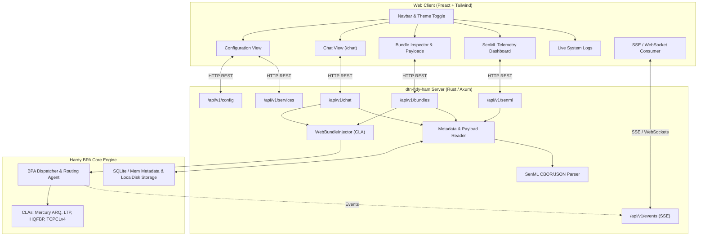

# Roadmap: Aligning `dtn-hdy-ham` with `dtn-android-messenger`

## 1. Executive Summary & Vision

The objective of this roadmap is to elevate the web application of **`dtn-hdy-ham`** to offer full user-facing feature parity with the companion native mobile application [**`dtn-android-messenger`**](../dtn-android-messenger/README.md).

`dtn-android-messenger` provides amateur radio operators with an intuitive mobile terminal for Delay/Disruption-Tolerant Networking (DTN BPv7 - RFC 9171), featuring:
* A conversation-based **Chat service** (`dtn://<callsign>/chat`).
* A rich **Bundle Inspector** supporting automatic detection and rendering of Markdown, images, vocal notes (audio), and binary payloads.
* A live **SenML Telemetry Dashboard** (RFC 8428) displaying real-time IoT and sensor values with custom labels and historical graphs.
* Dynamic management of **Local Services**, **Static Routes**, **Convergence Layer Adapters**, and **BPSec BIB HMAC-SHA256 authentication** (RFC 9103).

By combining `dtn-hdy-ham`'s high-performance in-process Rust BPA (`hardy`), its amateur radio CLAs (LTP, HQFBP, Mercury ARQ, TCPCLv4), and a modern responsive web frontend (Vite + Preact + Tailwind CSS), operators will enjoy a cross-platform desktop and mobile web interface with zero installation overhead.

---

## 2. Feature Parity & Gap Analysis Matrix

| Feature / Domain | `dtn-android-messenger` (Kotlin/Compose) | `dtn-hdy-ham` Current State | Target in `dtn-hdy-ham` Web Console |
| :--- | :--- | :--- | :--- |
| **Configuration Dashboard** | Read/write settings in SQLite Room DB | **Delivered (WP1)**: Read-only active config cards & JSON inspector | WP6: Add interactive runtime configuration |
| **Generic Bundle Sending** | Dedicated screen for text & files | **Delivered (WP1/WP7)**: REST API & Form for text, file attachments & voice notes | Enhanced with BPSec flags & preview |
| **Bundle Storage & Inspection** | Registry of all bundles (inbox, outbox, delivered) + detail view | **Delivered (WP2)**: Storage listing, metadata inspector, hex dump & multi-format preview | Complete parity with mobile app (ADR 0011) |
| **Payload Renderers** | Auto-detects Text, Markdown, Image, Audio, Hex | **Delivered (WP2)**: In-browser Markdown, Image viewer, Audio player, Hex viewer | Complete parity with mobile app |
| **Chat Service** | Conversational bubble thread grouped by peer | **Delivered (WP3)**: Conversational thread UI, chat bubbles, unread tracking, persistent DB | Complete parity with mobile app (ADR 0012) |
| **Files Service & Retention** | File explorer & sticky retention | **Delivered**: Built-in files service (`/files`), sticky flag, metadata DB, auto-cleanup | Complete parity with mobile app (ADR 0013) |
| **Voice Notes & Audio Recording** | Native Opus audio recorder | **Delivered (WP7)**: In-browser Web Audio mic recorder + Ogg/Opus auto-remux | Complete parity with mobile app |
| **Real-Time Push / Updates** | Reactive Room DB Kotlin Flows | **Delivered (WP4 / ADR 0018)**: Server-Sent Events (SSE) `/api/v1/events` for bundles, chat, files, CLA states & logs | Complete parity with mobile app |
| **System Event Logs** | Dedicated `SystemLogScreen` | **Delivered (WP4 / ADR 0018)**: 500-entry ring buffer, `/logs` view with level filters, search, auto-scroll & export | Complete parity with mobile app |
| **SenML Telemetry** | `SENML_LAST` cards & `SENML_GRAPH` time series | **Delivered (WP5 / ADR 0021)**: RFC 8428 CBOR/JSON parser, `senml.db` storage, Open MCT API, live stream, responsive cards | Complete parity with mobile app |
| **Service Registry** | Dynamic registration of local EIDs & Viewer Types | **Delivered (Read-only)**: `/api/v1/services` active service discovery & SSE push | WP6: Add interactive in-browser registration |
| **Static Routing** | Rule editor in settings | **Delivered (Phase 3ter / ADR 0014)**: Dynamic Route Manager `/api/v1/routes`, immediate RIB push & hot-reload | Complete parity with mobile app |
| **BPSec Security** | BIB key management & verification policy | **Delivered (Phase 6 & 6bis / ADR 0020)**: Key vault (`keystore.toml`), HMAC-SHA256 policy, deterministic specificity, real crypto verification, atomic 0600 storage | Complete parity with mobile app |
| **Mobile & Field Ergonomics** | Native Android APK | **Delivered (WP7)**: Progressive Web App (PWA) offline shell, in-browser voice recorder + Ogg remux, mobile bottom navbar ($\ge 48\text{px}$) | Complete parity with mobile app |

---

## 3. High-Level System Architecture

---

## 4. Phased Implementation Roadmap

### Phase 1: Foundation (Completed)
* [x] **ADR 0009**: Axum web server and Preact single-page application.
* [x] **Embedded Axum Backend**: Optional `web` configuration block with address and `static-dir`.
* [x] **Active Configuration API**: `GET /api/v1/config` exposing station identity, CLAs, peers, schedules, and storage.
* [x] **Generic Bundle Dispatcher**: `POST /api/v1/bundles` supporting JSON text messages and `multipart/form-data` binary files.
* [x] **Automated Packaging Pipeline**: GitHub Actions matrix producing static self-contained bundles for Linux (musl), Windows (MSVC), and macOS (Universal).

---

### Phase 2: Bundle Storage Inspector & Multi-Format Viewer (`BUNDLE_LIST`) (Completed)
> **Goal**: Enable operators to inspect, filter, and view incoming, outgoing, and delivered bundles, with rich rendering of payloads matching `dtn-android-messenger`'s `BundleListScreen` and `PayloadUtils` (ADR 0011).

#### Deliverables:
1. [x] **Backend Endpoints (`/api/v1/bundles`)**:
   * `GET /api/v1/bundles`: List stored bundles with filtering by state (`inbox`, `outbox`, `delivered`), search query, and pagination.
   * `GET /api/v1/bundles?id=...`: Detailed metadata (Primary block, hop count, lifetime, creation timestamp, hex dump, preview).
   * `GET /api/v1/bundles/payload`: Raw payload stream with MIME type inference (`content-type`) and HTTP Range support.
   * `DELETE /api/v1/bundles?id=...`: Remove bundle from storage.
2. [x] **Payload Type Detection Engine (Rust)**:
   * Inspect first bytes and extension: detect Plain text, Markdown, Images (PNG, JPEG, GIF, WebP), Audio (WAV, MP3, OGG Opus vocal notes), and SenML.
3. [x] **Frontend UI Components (`dtn-hdy-ham/web`)**:
   * **Bundle List View**: Tabbed list (All, Inbox, Outbox, Delivered), status badges, search bar, and size indicators.
   * **Bundle Detail Modal/Drawer**:
     * Header metadata cards with copyable EIDs and timestamps.
     * **Markdown Renderer**: Sanitized GitHub-flavored markdown view.
     * **Image Viewer**: Responsive image preview with zoom and download.
     * **Audio Player**: HTML5 audio player for vocal notes with multi-source fallback.
     * **Hex Viewer**: Byte-by-byte hex/ASCII dump for arbitrary binary data.

---

### Phase 3: Dedicated Interactive Chat Service (`CHAT`) (Completed)
> **Goal**: Provide a real-time messaging interface similar to instant messengers, structured around conversations with peer stations (ADR 0012).

#### Deliverables:
1. [x] **Backend Chat Service & Storage (`/api/v1/chat`)**:
   * Sieve and deliver bundles destined for local chat endpoints (`dtn://<callsign>/chat`).
   * Group messages into persistent threads indexed by correspondent node EID (e.g. `dtn://statb/chat`).
   * Persistent SQLite storage (`chat.db`) surviving daemon restarts.
   * `GET /api/v1/chat/conversations`: List active conversation partners, last message snippet, timestamp, and unread counts.
   * `GET /api/v1/chat/messages?peer={peer_eid}`: Chronological message history for a conversation.
   * `POST /api/v1/chat/messages`: Send quick text message addressed to `dtn://<peer>/chat`.
   * `POST /api/v1/chat/conversations`: Create a new conversation explicitly.
   * `POST /api/v1/chat/read`: Mark conversation messages as read.
2. [x] **Frontend Chat Interface (`ChatView.tsx`)**:
   * Dual-pane responsive layout (conversations sidebar + chat bubble thread).
   * Navbar unread counter badge.
   * Visual delivery indicators: *Outbox* ⏳, *Sent* 📤, *Delivered* ✅.
   * New Chat modal dialog with autocomplete suggestions from active peers/routes.

---

### Phase 3bis: Dedicated Internal Files Service & Retention (`BUNDLE_LIST`) (Completed)
> **Goal**: Deliver a permanent, isolated file transfer endpoint on `dtn://<node>/files` with persistent SQLite indexing, HTTP Range streaming, and sticky retention (ADR 0013).

#### Deliverables:
1. [x] **Built-in Files Service Engine (`files_service.rs`)**:
   * Registers `dtn://<node>/files` with BPA on startup and stays permanently bound.
   * Stores payload files on disk (`files/`) and tracks metadata in SQLite (`files.db`).
   * Automatic background reaper purging expired non-sticky bundles.
2. [x] **REST API Endpoints (`/api/v1/files`)**:
   * `GET /api/v1/files`: List received file bundles with unread and sticky flags.
   * `GET /api/v1/files/{id}`: Detailed metadata with payload preview and missing-file degraded state detection.
   * `GET /api/v1/files/{id}/payload`: Streaming payload with RFC 9110 HTTP Range support (partial content `206` and suffix ranges).
   * `POST /api/v1/files/{id}/sticky`: Toggle permanent retention flag.
   * `DELETE /api/v1/files/{id}`: Delete file bundle and physical disk payload.
3. [x] **Frontend File Explorer (`FilesView.tsx`)**:
   * Searchable table view with sticky pin icons, unread badges, and sorting.
   * Detail view (Level 2) rendering Markdown, embedded images, audio player, or hex dump.
   * Reply button pre-filling the Generic Bundle Dispatcher.

---

### Phase 3ter: Dynamic Static Routing, TCPCLv4 Peering, Security (OWASP Top 10), Code Quality & Accessibility
> **Goal**: Enable interactive adding and deleting of static routes via the web console with immediate RIB application, provide a turnkey experience for pure TCPCLv4 amateur radio networking with gateway peering (e.g. F4JXQ) and scheduled contact windows (ADR 0014), and resolve all OWASP Top 10 security vulnerabilities (excluding AuthN/AuthZ), runtime/performance bugs, and accessibility (a11y) gaps identified during the repository-wide audit.

#### Deliverables (Routing & TCPCLv4 Peering):
1. [x] **Dynamic Route Manager & Immediate BPA Application (`RouteManager`)**:
   * Implement a persistent `HamRoutingAgent` that retains Hardy BPA's `RoutingSink` during daemon execution.
   * Add REST endpoints (`/api/v1/routes`):
     * `GET /api/v1/routes`: List all active static routes with pattern, destination CLA / next-hop, and priority.
     * `POST /api/v1/routes`: Add a new static route with immediate push into the BPA RIB without restarting the daemon.
     * `DELETE /api/v1/routes`: Remove a static route with immediate unrouting from the BPA RIB.
   * Persist added and deleted routes to the YAML configuration file (`routes` block) or static routes file to survive daemon restarts.
2. [x] **Automated Initialization with F4JXQ Peer & Default Route**:
   * In the setup wizard (`dtn-hdy-ham --wizard`), when the operator confirms connecting to peer F4JXQ via TCPCLv4:
     * Automatically insert the static route `pattern: "dtn://f4jxq-9/*"` with `next-hop: "dtn://f4jxq/"` (and CLA `tcpcl-f4jxq`).
     * Offer adding the DTN Default Gateway route `pattern: "dtn://**"` -> `next-hop: "dtn://f4jxq/"` so that traffic for any amateur radio correspondent routes seamlessly through the gateway.
   * Include permissive default RFC 9171 validation settings (`primary-block-integrity: false`, `bundle-age-required: false`) in generated configs to ensure immediate interoperability with mobile and third-party BPv7 implementations.
3. [x] **TCPCLv4 Startup Connection & Contact Coordinator Schedule (43 min)**:
   * **Startup Dial & Continuous Health**: Initiate the TCPCLv4 session immediately upon daemon startup and keep it open continuously as long as the link is healthy.
   * **Contact Coordinator Integration**: Bind TCPCLv4 to the existing `ContactCoordinator` engine with a default recurring period of 43 minutes (`*/43 * * * *`) acting as a periodic contact probe and reconnect gardian if the link dropped.
   * **No On-Demand Dial on Outbox Injection**: Bundles queued while the link is closed remain safely in the local BPA Outbox without triggering uncontrolled immediate dial attempts (accommodating alternate hamradio CLAs or awaiting hamnet readiness).
   * **Manual Connect Override**: Retain the on-demand connect trigger in the UI so operators can force an immediate reconnection at any time.
4. [x] **Real-Time TCPCLv4 Connection & Outbox Visual Status Indicators**:
   * Display live connection state badges (Connected 🟢, Disconnected 🔴, Dialing 🟡) for TCPCLv4 peers in the web console.
   * Render explicit store-and-forward Outbox status (⏳ *Queued in BPA Outbox*) on pending messages and file bundles.
5. [x] **Frontend Routes Management Interface (`ConfigView.tsx`)**:
   * Table of configured static routes with status, pattern matching preview, and delete button.
   * Modal form to add a new route: Pattern input (e.g. `dtn://f4jxq-9/*`), next-hop EID (e.g. `dtn://f4jxq/`), and target CLA selector.
   * Instant reactivity: route creation takes effect immediately in the routing table and autocomplete lists.
6. [x] **Enhanced Peer Suggestions**:
   * Expand chat and send bundle autocomplete candidates to include targets derived from active static routes (e.g. `dtn://f4jxq-9/chat` and `dtn://f4jxq-9/files`).

#### Deliverables (OWASP Top 10 Security Remediation — Excluding AuthN/AuthZ):
7. [x] **[OWASP A03:2021 – Injection] Fix Stored XSS in Markdown Renderers (`FilesView.tsx`, `ChatView.tsx`, `BundlesView.tsx`)**:
   * **Root Cause**:
     * In `dtn-hdy-ham/web/src/components/FilesView.tsx` (`renderMarkdownWithDataUris`, lines 71–124, injected via `dangerouslySetInnerHTML` at line 460), Markdown images `` were extracted into `images` *before* `escapeHtml(textWithImagePlaceholders)` was called, and at line 117 `img.url` was interpolated directly into `` without escaping `"` or `<`. A bundle payload containing `)` or `)` could break out of the `src` attribute and execute arbitrary JavaScript.
     * In both `dtn-hdy-ham/web/src/components/ChatView.tsx` (`renderMarkdown`, line 110, injected via `dangerouslySetInnerHTML` at line 537) and `FilesView.tsx` (line 108), the URL linkifier regex was running without full attribute escaping.
   * **Remediation**:
     * Created `dtn-hdy-ham/web/src/utils/markdown.ts` with strict URL scheme allowlisting for data-uri images (`image/png`, `image/jpeg`, `image/gif`, `image/webp`, `image/avif`) and http/https images, plus full escaping of `alt`, `src`, and `href` attributes.
     * Shared safe renderer across `ChatView.tsx`, `FilesView.tsx`, and `BundlesView.tsx`.
8. [x] **[OWASP A03/A05:2021 – Injection & Security Misconfiguration] Harden Raw Bundle Payload Serving Against Stored XSS & Header Injection (`dtn-hdy-ham/src/web/routes/mod.rs`)**:
   * **Root Cause**:
     * In `dtn-hdy-ham/src/web/routes/mod.rs` (`serve_payload_with_range`, lines 19–124), used by `GET /api/v1/bundles/payload` and `GET /api/v1/files/{id}/payload`, when `download` was `false` (default), responses were served with `Content-Disposition: inline; filename="{filename}"` without `X-Content-Type-Options: nosniff` or `Content-Security-Policy`. Dangerous web types like HTML or SVG opened directly in a browser could execute scripts in the web console's origin. Additionally, `filename` was interpolated without stripping `"`, `\r`, or `\n`.
   * **Remediation**:
     * Sanitized `filename` against quotes and CRLF characters.
     * Attached `X-Content-Type-Options: nosniff` and `Content-Security-Policy: default-src 'none'; sandbox` to all payload responses.
     * Enforced `disposition_type = "attachment"` for non-safe media types (HTML, SVG, unknown binaries), keeping inline only for verified safe media (safe images, audio, video, plain text, and markdown).
9. [x] **[OWASP A01:2021 – Broken Access Control / Path Traversal] Sanitize `storage_name` Before Joining onto `payload_dir` (`dtn-hdy-ham/src/bundle_inspector.rs`)**:
   * **Root Cause**:
     * In `dtn-hdy-ham/src/bundle_inspector.rs`, `get_bundle_payload` and `delete_bundle_from_storage` read `storage_name` from the `bundles` SQLite JSON metadata and passed it directly to `payload_dir.join(name)`.
   * **Remediation**:
     * Implemented `safe_payload_path` verifying that path components are strictly relative and normal (`std::path::Component::Normal`), explicitly disallowing `..`, `/`, `\`, and absolute paths before file read or deletion.
10. [x] **[OWASP A03:2021 – Injection] Prevent CRLF / Command Injection on Mercury TNC Control Socket & Config YAML (`mercury-cla/src/driver.rs`, `dtn-hdy-ham/src/wizard.rs`)**:
    * **Root Cause**:
      * In `mercury-cla/src/driver.rs`, callsigns and bandwidth strings were formatted directly into TNC control commands without character validation.
      * In `dtn-hdy-ham/src/wizard.rs`, `data_dir` and `web_address` were interpolated into a raw YAML string template without escaping.
    * **Remediation**:
      * Validated callsigns in `mercury-cla` against an alphanumeric and hyphen allowlist (`[A-Za-z0-9-]`) before transmission.
      * Escaped backslashes and double quotes in `wizard.rs` before generating YAML configs.
11. [x] **[OWASP A04/A05:2021 – Unbounded Allocation / DoS] Enforce Frame, Segment, and Body Size Caps in CLAs and Web Server (`ltp-cla`, `mercury-cla`, `dtn-hdy-ham`)**:
    * **Root Cause**:
      * **LTP Green Segment OOM**: In `ltp-cla/src/driver.rs`, `entry.data.resize(end_offset, 0)` allowed unbounded allocation from untrusted SDNV offsets.
      * **Mercury Data Frame OOM**: In `mercury-cla/src/driver.rs`, `data_read_loop` allocated `vec![0u8; length]` directly from a 4-byte header up to 4 GiB.
      * **Mercury Control Line Buffer OOM**: Accumulation without limit on missing newline in `control_read_loop`.
      * **Web Multipart Upload & CORS**: `CorsLayer::permissive()` allowed cross-origin execution from external origins.
    * **Remediation**:
      * In `ltp-cla`, capped green bundle reassembly at 16 MiB, added integer overflow checks, and limited concurrent green sessions to 64.
      * In `mercury-cla`, capped data frames to 16 MiB max and control line buffer to 4096 bytes.
      * In `dtn-hdy-ham/src/web/mod.rs`, restricted CORS origins strictly to localhost / loopback interfaces and set `DefaultBodyLimit::max(64 MiB)`.
12. [x] **[OWASP A10:2021 – SSRF] Fix DNS Rebinding TOCTOU and IPv6-Mapped IPv4 Check in `dtnbasket` (`src/bin/dtnbasket.rs`)**:
    * **Root Cause**:
      * `is_safe_ip` did not block `0.0.0.0/8`, CGNAT `100.64.0.0/10`, and used `to_ipv4()` rather than `to_ipv4_mapped()`.
    * **Remediation**:
      * Updated `is_safe_ip` with `to_ipv4_mapped()`, blocking `0.0.0.0/8`, `100.64.0.0/10` (RFC 6598), loopbacks, link-locals, and private addresses.

#### Deliverables (Code Quality, Bugs & Performance Remediation):
13. [x] **[Bug] Fix Unread Files Badge Key Mismatch Between Backend and Frontend (`dtn-hdy-ham/src/web/routes/files.rs` & `dtn-hdy-ham/web/src/App.tsx`)**:
    * **Remediation**:
      * Returned `{ "unread": count, "unread_count": count }` in `dtn-hdy-ham/src/web/routes/files.rs` and updated `App.tsx` with fallback `data.unread_count ?? data.unread ?? 0`.
14. [x] **[Bug] Render Formatted Markdown in `BundlesView.tsx` Inspector Modal (`dtn-hdy-ham/web/src/components/BundlesView.tsx`)**:
    * **Remediation**:
      * Used the shared `renderMarkdown` utility in `BundlesView.tsx` with image support when inspecting `text/markdown` payloads.
15. [x] **[Performance & Async Correctness] Offload Synchronous `ffmpeg` Subprocess and Cap File/SQLite Previews (`dtn-hdy-ham/src/web/routes/bundles.rs`, `files.rs`, `bundle_inspector.rs`)**:
    * **Remediation**:
      * Offloaded `maybe_remux_webm_to_ogg` to `tokio::task::spawn_blocking`.
      * Capped text previews to 16 KiB and hex dumps to 4 KiB in `bundle_inspector.rs`.
      * Capped file payload previews to 64 KiB in `files.rs`.
16. [x] **[Bug / Reliability] Keep TCPCLv4 Startup Connector & Status Synchronized Across Disconnections (`dtn-hdy-ham/src/server.rs`)**:
    * **Remediation**:
      * Replaced the infinite 1s loop with exponential backoff up to 5 attempts before cleanly yielding to the `ContactCoordinator` schedule, preventing link flapping.

#### Deliverables (Accessibility / a11y Quick Wins — `dtn-hdy-ham/web`):
17. [x] **[a11y] Landmarks, Skip Link & Navigation Semantics (`App.tsx`, `Navbar.tsx`)**:
    * **Remediation**:
      * Added visible focus skip link (`#main-content`) in `App.tsx`.
      * Added `aria-label="Main navigation"` to `<nav>`, `aria-current="page"` on active tab, `aria-hidden="true"` on decorative emojis, and `aria-label` / `aria-pressed` on the theme toggle button.
18. [x] **[a11y] Accessible Modals (`role="dialog"`, `aria-modal`, `Escape` Handler) (`ChatView.tsx`, `BundlesView.tsx`)**:
    * **Remediation**:
      * Added `role="dialog"`, `aria-modal="true"`, and `aria-labelledby` on all modal dialogs.
      * Added `Escape` key event listeners to close active modals.
      * Added `aria-label="Close modal"` to close buttons.
19. [x] **[a11y] Form Labels, Keyboard-Interactive Cards & Icon-Only Button Labels (`ConfigView.tsx`, `ChatView.tsx`, `FilesView.tsx`, `BundlesView.tsx`, `SendBundleView.tsx`)**:
    * **Remediation**:
      * Associated `for`/`id` labels with inputs and selects across configuration, send bundle, chat, and files views.
      * Made file cards keyboard-interactive with `role="button"`, `tabIndex={0}`, and `Enter`/`Space` handlers.
      * Added `aria-label` on all icon-only buttons (copy, reload, download, delete, pin, back).
20. [x] **[a11y] Live Regions (`role="alert"`, `aria-live`) & WCAG AA Contrast Adjustments**:
    * **Remediation**:
      * Added `role="alert"` on error banners and `aria-live="polite"` on transient toast notifications.
      * Upgraded secondary text contrast from `text-slate-400` to `text-slate-500 dark:text-slate-400` to meet WCAG AA standards.

---

### Phase 4: Real-Time Event Push & Live Tracing Console (`SYSTEM_LOG`) (Completed)
> **Goal**: Eliminate manual refreshing and provide live observability into radio links, bundle receptions, and daemon diagnostics (ADR 0018).

#### Deliverables:
1. [x] **Server-Sent Events (SSE) Stream (`GET /api/v1/events`) & In-Memory Ring Buffer**:
   * Standard `stderr` output preserved for Docker/systemd alongside a 500-entry in-memory ring buffer (`LogBufferLayer`).
   * `GET /api/v1/logs`: Returns initial 500-entry history snapshot.
   * `GET /api/v1/events?logs=true`: Streams real-time tracing logs without flooding non-log tabs.
   * Broadcast real-time events to connected browser tabs:
     * `services_update`: Active DTN services registered via gRPC or built-in.
     * `bundles_update`: New incoming bundle stored or evicted.
     * `chat_message`: Real-time chat message broadcast.
     * `file_received`: Real-time file reception broadcast.
     * `cla_state_changed`: CLA connection state transitions (Connected, Disconnected, Error).
     * `contact_window`: Schedule coordinator contact window opening or closing.
     * `log_entry`: Live tracing records (`tracing-subscriber` layer).
2. [x] **Frontend Reactive State & Non-Intrusive Audio Chime**:
   * Preact reactive state automatically updating Chat, Files, Bundles, and active services without manual page reload.
   * Unread notification badges on tabs updated in real time.
   * Synthesized audio chime using standard Web Audio API (`AudioContext`) with operator toggle (🔔/🔕) in navigation bar.
   * Live SSE connection health badge (🟢 Live, 🔴 Disconnected, 🟡 Connecting) in navigation bar.
3. [x] **System Log Console View (`/logs`) (`LogsView.tsx`)**:
   * Live streaming terminal viewer with level filtering (ALL, INFO, WARN, ERROR, DEBUG, TRACE).
   * Real-time text search filter across messages, severity, and module targets.
   * Smart auto-scroll with pause on user scroll-up and resume toggle.
   * Local clear button and export/download to text file (`dtn-logs-<date>.txt`).

---

### Phase 5: Telemetry & SenML IoT Gateway & Dashboard (`SENML_LAST`) (Completed)
> **Goal**: Decode, normalize, persist and stream IoT telemetry formatted in RFC 8428 SenML (CBOR and JSON), matching `dtn-android-messenger`'s `SENML_LAST` view and offering an Open MCT compatible time-series API (ADR 0021).

#### Deliverables:
1. [x] **SenML Parser Engine & Normalization (Rust, RFC 8428)** (`senml/parser.rs`):
   * Full RFC 8428 SenML parser with auto-detection of JSON (`application/senml+json`) and CBOR (`application/senml+cbor`).
   * Support for base fields (`bn`, `bt`, `bu`, `bv`) and measurements (`n`, `u`, `v`, `vs`, `vb`, `t`).
   * Normalization of absolute POSIX timestamps in milliseconds and relative RFC 8428 timestamps anchored to DTN bundle `creation_timestamp`.
2. [x] **SQLite Time-Series Storage & In-Memory Cache** (`senml/storage.rs`):
   * Dedicated SQLite database `senml.db` configured with `WAL`, `synchronous = NORMAL`, and foreign keys.
   * Tables: `metric_dictionary` (metric metadata, aliases, display order, visibility) and `telemetry_history` (`WITHOUT ROWID`, indexed on `(metric_id, timestamp ASC)`).
   * In-memory cache `metric_name -> metric_id` to eliminate redundant SELECT queries during high-throughput ingestion.
   * Batch insertion with `ON CONFLICT REPLACE` guaranteeing complete idempotence against duplicate/out-of-order DTN bundles.
   * Synchronization with YAML station config (`senml.metrics`).
3. [x] **Internal BPA Service (`dtn://<node>/senml`) & BPSec Security** (`senml/service.rs`):
   * Permanent built-in service bound to `dtn://<node>/senml`.
   * Cryptographic verification using BPSec BIB Keystore matching policy (drops invalid signatures under `strict`).
4. [x] **Unified REST & Open MCT Telemetry API** (`web/routes/senml.rs`):
   * `GET /api/v1/senml/metrics`: Lists discovered metrics with aliases and units.
   * `GET /api/v1/senml/metrics/latest`: Snapshot of the latest point per metric (with optional `?id=...`, `?ids=...`, and `?dashboard_only=true` filtering).
   * `GET /api/v1/senml/history`: Open MCT Telemetry Request compliant interval query (`?id=...&start=...&end=...`) returning `[{ "utc": ..., "value": ... }]`.
   * `GET /api/v1/senml/stream`: Server-Sent Events stream emitting live `event: telemetry` points as they are ingested.
   * `GET|POST|PUT|DELETE /api/v1/senml/dashboard/cards`: Dashboard card management (add, inline alias rename, reorder, remove, clear).
5. [x] **Frontend Telemetry Dashboard (`SenmlView.tsx`)**:
   * Card grid adhering to `dtn-android-messenger`'s `SENML_LAST` ergonomics.
   * Responsive cards with current value, engineering unit, relative & UTC timestamps, and live update flash animation.
   * Inline editable alias, up/down card reordering, and removal.
   * Modal dialog to add cards from auto-discovered metrics or manual input.
   * Live streaming updates via EventSource `/api/v1/senml/stream`.
6. [x] **Comprehensive End-to-End Verification (`examples/test_e2e_hardy_duo.py`)**:
   * 76/76 automated end-to-end integration tests passing across two interconnected Hardy nodes (`STATA` <--> `STATB` via TCPCLv4), covering BPSec, Chat, Files, and SenML telemetry (JSON & CBOR).

---

### Phase 6: Service Registry & BPSec Security Management
> **Goal**: Enable interactive, in-browser administration of custom node services and BPSec authentication policies without manual YAML editing.

#### Deliverables:
1. **Local Service Registry (`/api/v1/services`)**:
   * Define additional service EIDs (e.g. `dtn://<callsign>/files`, `dtn://beacon/`, `dtn://<callsign>/telemetry`).
   * Assign visual viewer modes (`CHAT`, `BUNDLE_LIST`, `SENML_LAST`).
   * Enable/disable multicast/broadcast promiscuous listening.
2. [x] **BPSec BIB Key & Policy Vault (`/api/v1/security`) (ADR 0020)**:
   * Manage HMAC-SHA256 symmetric keys (RFC 9103 / RFC 9172) with strict inbound/outbound directional separation.
   * Specificity pattern matching (`dtn://*`, `dtn://f5kuv/*`, `dtn://*/chat`, `ipn:0.1.*`).
   * Configurable validation policy: *Warn* (default), *Strict* (drop invalid signatures), or *Ignore*.
   * In-browser key vault integrated into `ConfigView.tsx` with 256-bit random key generator and POSIX `0600` protection (`keystore.toml`).
   * Visual trust badges across Chat, Files, and Bundles.

---

### Phase 6bis: BPSec Cybersecurity Hardening, Cryptographic Integrity & Rust Reliability
> **Goal**: Remediate cryptographic edge cases, eliminate unprotected `.unwrap()` calls, enforce atomic secret storage, and remove redundant CBOR parsing/memory copies identified during the post-implementation cybersecurity audit of `ADR 0020`.
> **Scope Note**: Web application user authentication/authorization (IAM) is intentionally out of scope at this stage. CORS origin rules remain unchanged.

#### Deliverables (Cryptographic & BPSec Protocol Hardening):
1. [x] **[Crypto / Spoofing] Enforce Identity Binding Between BIB `security_source` and Bundle `primary.source` & Mandatory Payload Block (#1) Coverage (`dtn-hdy-ham/src/security/keystore.rs`)**:
   * **Root Cause**:
     * In `verify_bundle` (`dtn-hdy-ham/src/security/keystore.rs`), `sec_source` is extracted from `parsed.bibs.values().next()` (an arbitrary entry in an unordered `HashMap`) and looked up in `keystore.find_inbound_key(&sec_source_str)`, without checking that `sec_source` belongs to the same node as `parsed.bundle.primary.id.source`. A third-party node $C$ holding a valid inbound key could craft a bundle with `primary.source = dtn://f5kuv/chat` and `bib.security_source = dtn://station_c/chat`, causing `ChatService` and `FilesService` to attribute the message to `F5KUV` with a green `Valid` badge.
     * Additionally, if a BIB block only targets an extension or primary block and does not target the payload block (`#1`), `begin_payload_verification` returns an empty `verifiers` collection and `verify_bundle` still returns `AuthStatus::Valid`.
   * **Specification & Remediation**:
     * Verify that a BIB operation specifically targets payload block `#1` (`parsed.bibs.get(&1)`). If no BIB targets block `#1`, the payload is not authenticated (`AuthStatus::Invalid` if other BIBs exist without covering payload, or `AuthStatus::Unsigned` if no BIB exists).
     * Enforce identity concordance: normalize both `bib_op.source()` and `parsed.bundle.primary.id.source` to their node identity (`normalize_peer_node` or exact EID/node match, e.g., `dtn://f5kuv/` or `ipn:N.*`). If the BIB security source node does not match the primary bundle source node, immediately return `AuthStatus::Invalid`.
     * Ensure `verifiers` from `begin_payload_verification` is non-empty and covers target block `#1` before returning `AuthStatus::Valid`.
     * Match the inbound key against `parsed.bundle.primary.id.source.to_string()` (so service-specific inbound patterns like `dtn://*/chat` or `dtn://f5kuv/chat` work consistently even if `bib.security_source` is the node-level EID `dtn://f5kuv/`).

2. [x] **[Crypto / Trust Spoofing] Perform Real Cryptographic Verification in Bundle Inspector & Align Policy / Badge Semantics (`dtn-hdy-ham/src/bundle_inspector.rs`, `chat_service.rs`, `files_service.rs`, `SecurityBadge.tsx`)**:
   * **Root Cause**:
     * In `list_bundles_from_db` (`dtn-hdy-ham/src/bundle_inspector.rs`), `auth_status` is set to `"valid"` whenever a block with `block_type == 11` (`BlockIntegrity`) exists in the SQLite JSON metadata (`let auth_status = if has_bib { "valid" } else { "unsigned" };`), without verifying the HMAC or consulting the `DirectionalKeyStore`. Any forged or corrupted BIB displays as `🛡️ Authentifié` in `BundlesView.tsx`.
     * In `ChatService::handle_delivered_bundle` and `FilesService::handle_delivered_bundle`, `verify_bundle` is executed even when `policy == VerifyPolicy::Ignore`.
     * UI badge requirement: `MissingKey` must display the same neutral icon (`❓`) as `Unsigned`.
   * **Specification & Remediation**:
     * Pass `&DirectionalKeyStore` (and `payload_dir: &Path`) into `list_bundles_from_db` and `get_bundle_detail` (or verify against the stored bundle file in `payload_dir` when `has_bib` is true) so `BundleSummary.auth_status` and `BundleDetail.auth_status` reflect actual `verify_bundle` results (`valid`, `invalid`, `missing_key`, `unsigned`).
     * In `verify_bundle` (or at the start of `ChatService` / `FilesService` / `bundle_inspector`), if `keystore.get_policy() == VerifyPolicy::Ignore`, short-circuit immediately and return `AuthStatus::Unsigned` without running cryptographic checks.
     * In `VerifyPolicy::Strict`, keep rejecting **only** `AuthStatus::Invalid` bundles; `AuthStatus::Unsigned` and `AuthStatus::MissingKey` must be accepted.
     * In `dtn-hdy-ham/web/src/components/SecurityBadge.tsx`, update the `missing_key` branch to use the same `❓` icon and neutral slate styling as `unsigned` (while preserving a descriptive tooltip/title if helpful, or unifying visual presentation with `unsigned`), and update `dtn-hdy-ham/web/tests/security.spec.ts` accordingly.

3. [x] **[Routing & Key Selection] Deterministic Hierarchical Pattern Specificity, `(direction, pattern)` Uniqueness & Fail-Closed Outbound Signing (`dtn-hdy-ham/src/security/keystore.rs`, `web/routes/security.rs`, `web/routes/bundles.rs`, `web/routes/chat.rs`)**:
   * **Root Cause**:
     * `pattern_specificity` in `keystore.rs` scores patterns purely by counting non-`*` characters (`pattern.chars().filter(|c| *c != '*').count()`). Consequently, a generic service wildcard with a long service name (`dtn://*/long_service_name`, score 24) outranks a specific station node key (`dtn://f5kuv/*`, score 12).
     * `add_key` allows inserting multiple keys with the exact same `(direction, pattern)` and generates IDs from `OffsetDateTime::now_utc().unix_timestamp_nanos()`, which can collide on fast consecutive calls.
     * In `web/routes/bundles.rs` and `web/routes/chat.rs`, if `sign_bundle_with_key` returns `Err`, the code logs a `warn!` and dispatches the bundle unsigned (fail-open).
   * **Specification & Remediation**:
     * Implement a deterministic tier-based specificity function `pattern_specificity(pattern: &str) -> (u8, usize)` returning a tuple `(tier, non_wildcard_len)`:
       1. **Tier 5 (Exact EID, no `*`)**: e.g. `dtn://f5kuv/serviceb`, `ipn:1.2`
       2. **Tier 4 (Specific Node + Wildcard Service)**: e.g. `dtn://f5kuv/*`, `ipn:0.1.*` (prefix before `/` or last `.` has no `*`, suffix has `*`)
       3. **Tier 3 (Wildcard Node + Specific Service)**: e.g. `dtn://*/servicea` (node part has `*`, service part has no `*`)
       4. **Tier 2 (Scheme Wildcard)**: e.g. `dtn://*`, `ipn:*`
       5. **Tier 1 (Global Wildcard)**: `*`
     * Enforce uniqueness on `(direction, pattern)` in `DirectionalKeyStore::add_key`: if an entry with the same `direction` and normalized `pattern` already exists, either replace/update it in place or return an explicit error (`409 Conflict` in `POST /api/v1/security/keys`), and generate collision-free key IDs (e.g. monotonic atomic counter combined with random bytes or timestamp).
     * Make outbound signing strictly **Fail-Closed**: in `web/routes/bundles.rs` (`build_and_inject_bundle`) and `web/routes/chat.rs` (`do_send_chat_message`), if `find_outbound_key` returns `Some(key)` and `sign_bundle_with_key` fails, abort bundle injection and return `StatusCode::INTERNAL_SERVER_ERROR` with the signing error message.

4. [x] **[Secrets & Storage Security] Key Format Disambiguation, Minimum Key Length, Domain-Separated Fingerprint, Atomic `0600` File Creation & Memory Zeroization (`dtn-hdy-ham/src/security/keystore.rs`, `dtn-hdy-ham/Cargo.toml`)**:
   * **Root Cause**:
     * `parse_key_input` treats any even-length string $\ge 16$ chars matching `[0-9a-fA-F]` as hex, causing hex-looking passphrases to be decoded to half their byte length, and accepts 1-byte keys.
     * `compute_fingerprint` computes an unsalted `SHA256(secret)[..8]`, exposing short passphrases to offline dictionary attacks via `GET /api/v1/security/keys`.
     * `DirectionalKeyStore::persist` calls `fs::write(path, toml_str)` before `fs::set_permissions(path, 0o600)`, creating a TOCTOU window where `keystore.toml` is created with default `umask` (`0644`), ignores `set_permissions` errors (`let _ = ...`), and truncates in place (non-atomic).
     * `KeyEntry` and `KeyFileEntry` derive `Debug` on plaintext secret fields, and secrets are not zeroized in memory when dropped.
   * **Specification & Remediation**:
     * **Key Input Rules (`parse_key_input` & validation)**:
       * Decode as hex **only** if prefixed with `0x`/`0X` or if the trimmed string is **exactly 64 ASCII hex characters** (256-bit key). Otherwise treat as a UTF-8 passphrase.
       * Enforce minimum secret strength in `add_key`: require at least **16 bytes** (either $\ge 16$-byte UTF-8 passphrase or $\ge 16$-byte / 32-hex-char raw key; return `400 Bad Request` on shorter secrets).
     * **Domain-Separated Fingerprint (`compute_fingerprint`)**:
       * Compute `HMAC-SHA256(key = secret, message = b"dtn-hdy-ham-bpsec-fingerprint-v1")` (or salted SHA-256 with fixed domain separator) and encode the first 8 bytes as `SHA256:<16-hex-chars>`.
     * **Atomic `0600` Persistence (`persist`)**:
       * Write to a temporary file `<keystore_path>.tmp` opened on Unix with `std::os::unix::fs::OpenOptionsExt::mode(0o600)` (so the file is born with `0600` permissions before a single byte is written), `sync_all()`, explicitly enforce `set_permissions(0o600)` with `?` error propagation, and atomically `fs::rename(&tmp_path, path)?`.
     * **Redacted `Debug` & `zeroize`**:
       * Implement custom `fmt::Debug` for `KeyEntry` and `KeyFileEntry` printing `"<redacted>"` for `secret` / `key_hex`.
       * Add `zeroize` (or manual zeroing in `Drop` for `KeyEntry` / `KeyFileEntry`) so secret bytes are overwritten with zeros on removal/drop.

5. [x] **[Reliability & Performance] Eliminate Unprotected `.unwrap()` Calls & Redundant CBOR Parsing / Memory Copies (`dtn-hdy-ham/src/security/keystore.rs`, `chat_service.rs`, `files_service.rs`, `web/routes/bundles.rs`, `web/routes/chat.rs`)**:
   * **Root Cause**:
     * `DirectionalKeyStore` uses `.unwrap()` on all 12 `RwLock::read()` / `RwLock::write()` acquisitions, risking poison panic propagation across the daemon, and holds read locks while performing synchronous file I/O in `persist()`.
     * In `sign_bundle_with_key`, the newly built bundle is copied (`Bytes::copy_from_slice`) and parsed, signed, and then parsed a second time just to return `hardy_bpv7::bundle::Bundle`.
     * In `ChatService` and `FilesService`, `verify_bundle` copies the full bundle buffer (`Bytes::copy_from_slice`) and parses it, then `handle_delivered_bundle` immediately calls `hardy_bpv7::parse::parse(data)` a second time.
   * **Specification & Remediation**:
     * Replace all `RwLock::read().unwrap()` and `RwLock::write().unwrap()` in `keystore.rs` with `.unwrap_or_else(|poisoned| poisoned.into_inner())` (and audit modified files to ensure zero unprotected `.unwrap()` in production code).
     * In `persist()`, clone the `KeystoreConfigFile` snapshot while holding the lock, `drop` the lock guards, and perform TOML serialization + disk write outside the lock.
     * Refactor `sign_bundle_with_key` to accept `(&hardy_bpv7::bundle::Bundle, &[u8], &KeyEntry, Option<Eid>) -> Result<Vec<u8>>`, eliminating both the pre-parse and post-parse (since signing only adds a BIB block and never alters `bundle.primary.id`).
     * Refactor `verify_bundle` to accept `Bytes` (or `&ParsedBundle` + `&Bytes`) so `ChatService` and `FilesService` parse the incoming `Bytes` **once** (zero-copy) and pass the parsed structure to verification and payload extraction.

#### Verification & Acceptance Criteria for Phase 6bis:
* Unit tests in `dtn-hdy-ham/src/security/keystore.rs` covering:
  * Deterministic tier hierarchy (`dtn://f5kuv/*` beats `dtn://*/very_long_service_name`).
  * Identity mismatch rejection (`primary.source = dtn://f5kuv/chat` signed by `security_source = dtn://other/chat` $\rightarrow$ `AuthStatus::Invalid`).
  * Minimum key length rejection ($< 16$ bytes rejected) and disambiguated hex vs. passphrase parsing.
  * Uniqueness on `(direction, pattern)`.
  * Unix file mode `0o600` check on `keystore.toml` and redacted `format!("{:?}", key_entry)` check.
* Integration tests in `dtn-hdy-ham/tests/` verifying `BundleSummary.auth_status` accuracy in `bundle_inspector_test.rs`, `VerifyPolicy::Ignore` short-circuiting, and `bpsec_chat_files_test.rs`.
* E2E Playwright test `dtn-hdy-ham/web/tests/security.spec.ts` verifying unified `❓` badge on `missing_key` and `unsigned`.
* Zero warnings on `cargo clippy --workspace --all-targets` and `cargo fmt --check`.

---

### Phase 7: Progressive Web App (PWA) & Mobile Field Ergonomics
> **Goal**: Turn the web dashboard into an installable mobile terminal for field tablets and smartphones.

#### Deliverables:
1. **PWA Manifest, Service Worker & Offline Caching**:
   * [x] Web App Manifest (`manifest.webmanifest`) with standalone display mode, app icons, and theme color.
   * [x] Service worker caching frontend static assets (App Shell) for instant offline loading.
   * [x] Hybrid Cache/Network-First strategy with offline consultation for cached conversations (`/api/v1/chat/*`) and files (`/api/v1/files/*`).
2. **Field Ergonomics, Touch Controls & Notifications**:
   * [x] In-browser microphone voice recorder in the Generic Bundle Dispatcher (`SendBundleView.tsx`).
   * [x] Multi-source HTML5 audio preview before dispatching.
   * [x] Automatic lossless remuxing of WebM/Opus to pure RFC 7845 Ogg/Opus on backend injection.
   * [x] High-contrast dark and light mode themes toggleable in navbar.
   * [x] Mobile bottom navigation bar on smartphone viewports with $\ge 48\text{px}$ touch targets for gloved operations.
   * [x] Web Notification API integration for background operator alerts on incoming chat messages when screen is off/unfocused.

---

### Phase 8: Simplex Radio Medium Access Control & Collision Mitigation (TDMA / Half-Duplex MAC)
> **Goal**: Prevent RF packet collisions and PTT contention on shared single-frequency simplex channels (e.g., FSK 9600 Direwolf, VHF/UHF packet radio, and terrestrial half-duplex transceivers).

#### Context & Problem Statement:
* LTP (RFC 5326) was historically designed for full-duplex deep space / satellite links (separate uplink and downlink frequencies).
* On a simplex radio channel (shared single frequency in half-duplex alternat), transmitting locally blinds/desensitizes the receiver. Simultaneous transmissions of data segments, Checkpoints (CP), Report Segments (RS), and Report Acks (RA) will collide without medium access control (MAC).

#### Deliverables:
1. **TDMA Time-Slotting Coordinator for Simplex CLAs**:
   * Synchronized time-division multiple access using system clock (NTP / GPS time).
   * Even/odd second or configurable slot allocation (e.g., Station A transmits in slot $0 \le t < T$, Station B in slot $T \le t < 2T$).
   * CLA outbound buffer holdoff: queue outgoing LTP frames in memory and transmit them in bursts exclusively during the station's assigned TX slot.
2. [x] **Half-Duplex Ping-Pong / Turnaround Guard State Machine (Delivered in `hardy-ltp-cla`)**:
   * Turn-based MAC for non-time-synchronized simplex links: sender transmits up to a Checkpoint, then explicitly releases PTT and enters listening state (`HalfDuplexPacer`).
   * Configurable turnaround delay margin (*PTT keyup/tail guard time*) before receiver replies with Report Segments (`WaitForReport`, `FixedDwell`).
3. **KISS TNC CSMA Parameters Management**:
   * Expose KISS parameters (`TXDELAY`, `PERSIST`, `SLOTTIME`, `TXTAIL`) in CLA YAML configuration to fine-tune Direwolf / hardware TNC p-persistent CSMA.
4. [x] **Unidirectional Simplex Profile (LTP Green Data / HQFBP) (Delivered)**:
   * Optimized configuration profiles for strictly unidirectional simplex channels using LTP Lane 1 (Green Data in `hardy-ltp`) and dedicated `hardy-hqfbp-cla` broadcast adapter, guaranteeing zero return transmissions and zero collisions.

---

### Phase 9: Repository Security Scanning, Static Analysis & Code Quality Guardrails
> **Goal**: Protect the repository against secrets leakage, supply-chain vulnerabilities, unsafe memory/FFI regressions, and code smell regressions with both fast local runs for autonomous coding agents and automated enforcement in GitHub Actions CI/CD.

#### Prioritized Security Matrix:

##### Priorité 1 : Hygiène immédiate, Secrets & Audit des dépendances (Implémentation immédiate)
* [x] **Secret Scanning (Gitleaks)** :
  * Détection proactive des secrets, clés privées, jetons API et HMAC avant commit et dans la CI.
  * Fichier de configuration `.gitleaks.toml` dédié, intégrant des règles adaptées et allowlistant les fixtures de test et clés factices DTN/BPSec.
* [x] **Audit des vulnérabilités logicielles des dépendances (RustSec & Frontend)** :
  * Audit des crates Rust via `cargo audit` adossé à la base RustSec Advisory Database.
  * Audit des dépendances Web Preact/Vite via `pnpm audit` / `npm audit`.
* [x] **Script d'exécution local unifié (`scripts/check-security.sh`)** :
  * Outil CLI simple, rapide (< 5 secondes) et reproductible exécutable par l'agent ou le développeur en amont de tout commit.
  * Mode permissif/guidé en local (affichage clair des commandes d'installation si un binaire manque) et mode strict (bloquant, code de retour non-nul) en CI.
* [x] **Intégration CI GitHub Actions (`.github/workflows/ci.yml`)** :
  * Ajout d'une étape ou d'un job de vérification de sécurité automatisé sur chaque Pull Request et push sur `main`.
* [x] **Mise à jour des consignes de développement (`AGENTS.md`)** :
  * Ajout de `./scripts/check-security.sh` dans les vérifications impératives de l'agent.

##### Priorité 2 : Conformité des licences, bannissement de dépendances & Couverture de tests
* [x] **Gouvernance des licences et doublons (`cargo-deny`)** :
  * Validation stricte des licences autorisées (MIT, Apache-2.0, BSD-3-Clause) et blocage des licences restrictives ou incompatibles (GPLv3 virale non souhaitée sur les bibliothèques) via `deny.toml`.
  * Détection et interdiction des failles d'advisory, bans et sources non autorisées intégrées dans `scripts/check-security.sh` et la CI.
* [x] **Surveillance de la couverture de code (`cargo-llvm-cov`)** :
  * Intégration de la couverture source native LLVM (`cargo-llvm-cov`) via le script unifié `scripts/check-coverage.sh` (console, HTML et export LCOV).
  * Mesure globale sur l'ensemble du workspace (>65% couverture globale, >90% sur `ltp`, `pacing`, `keystore`, et parsers SenML).
  * Job automatisé `code-coverage` dans GitHub Actions (`.github/workflows/ci.yml`) avec génération d'artéfact LCOV.
* [x] **Garde-fous Zéro-Panic et Zéro-Unwrap (Clippy & Linter)** :
  * Interdiction stricte de `.unwrap()` et `panic!()` dans le code de production (`--lib`, `--bins`).
  * Encodage `clippy::unwrap_used` et `clippy::panic` en erreur bloquante et vérification dans l'étape `[2/6]` de `check-security.sh`.
* [x] **Hook Git Pre-Commit Automatisé (`scripts/install-hooks.sh`)** :
  * Installation de `.git/hooks/pre-commit` bloquant localement tout commit non conforme aux 6 étapes de sécurité.
* [x] **Tests Fuzzing Continus (Continuous Fuzz Smoke Testing)** :
  * Cibles `cargo-fuzz` sur le décodage LTP et le parsing de trames HQFBP (`segment_decode`, `sdnv_kiss`, `parse_frame`).
  * Job automatisé `fuzz-smoke-tests` dans GitHub Actions CI.
* [x] **Mutation Testing & Robustesse des Tests (`cargo-mutants`)** :
  * Exécution de `cargo-mutants` sur `cla-commons` avec 100% de neutralisation des mutants (24 tués, 3 timeouts, 0 manqués).

##### Priorité 3 : Analyse sémantique avancée (SAST) & Sécurité mémoire
* [ ] **Analyse statique approfondie (GitHub CodeQL / Semgrep)** :
  * Détection sémantique des vulnérabilités web/API (traversée de répertoires sur `/api/v1/files`, SSRF, désérialisation non bornée, injections).
* [ ] **Audit du code `unsafe` (`cargo-geiger`)** :
  * Cartographie et contrôle continu du code `unsafe` direct et transitif dans l'écosystème Rust utilisé.

---

## 5. Technical Requirements & Dependencies

### Backend (Rust / Axum)
* `tower-http`: `cors`, `fs`, `trace`, `compression`.
* `tokio-stream` / `async-stream`: Server-Sent Events (SSE).
* `hardy-cbor` / `ciborium`: Decoding CBOR SenML and primary bundle headers.
* `rusqlite` / `hardy-sqlite-storage`: Fast querying for bundle metadata, conversations, and SenML snapshots.

### Frontend (Preact / TypeScript / Tailwind)
* `@preact/signals`: Lightweight reactive state management.
* `lucide-preact`: Clean, lightweight vector icons matching modern mobile terminals.
* `marked` / `dompurify`: Safe, sanitized Markdown rendering.
* `uplot` (or `chart.js`): High-performance, zero-bloat sensor graphing for telemetry.

---

## 6. Regulatory & Amateur Radio Compliance

All developments throughout this roadmap must strictly maintain hamradio regulatory compliance:
1. **ITU Article 25 Compliance (No Encryption)**:
   * Communication over amateur radio CLAs must remain in cleartext.
   * BPSec Block Confidentiality Blocks (BCB, RFC 9172) are prohibited on amateur RF links.
   * Only **Block Integrity Blocks (BIB HMAC-SHA256)** are permitted for sender authentication and message integrity.
2. **Callsign Identification & RADIANT Conventions**:
   * Default node EIDs follow `dtn://<callsign.to_lowercase()>/`.
   * Clear source identification on all outgoing transmissions.
